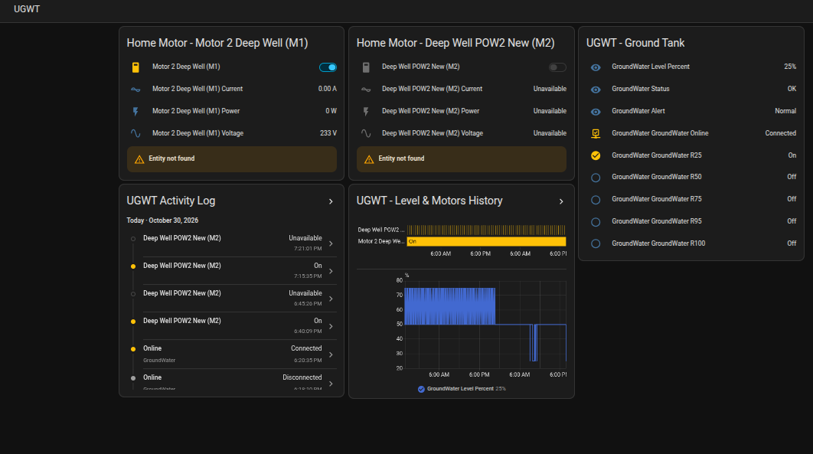
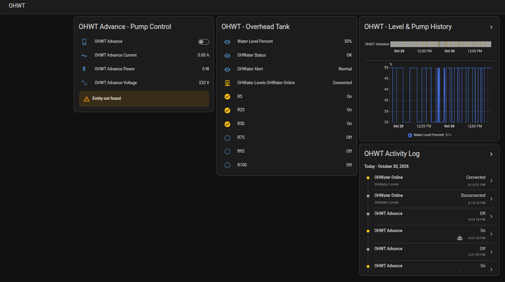
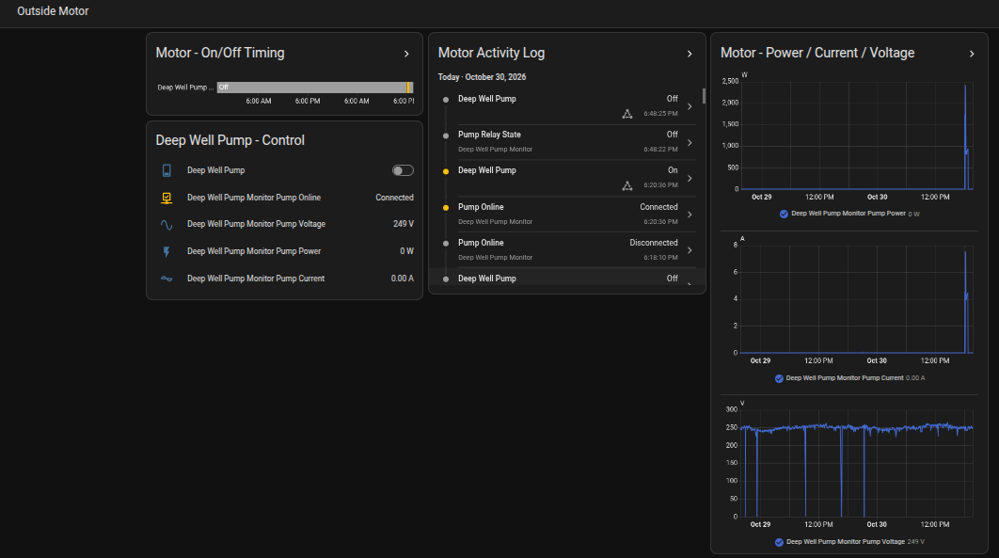
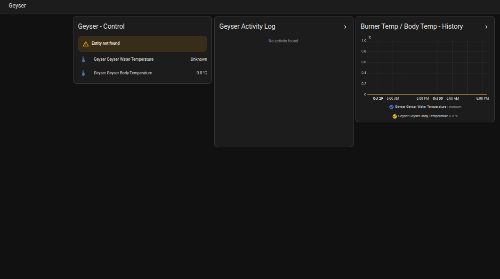

# Smart Water Management & Home IoT Automation

### Home Assistant | ESP8266/ESP32 | MQTT | Linux | Sonoff | ESPEasy

A practical Home IoT automation project built to monitor water storage tanks, automate water pump operations, track electrical measurements, and manage connected devices through a centralised Home Assistant dashboard.

The system integrates embedded controllers, float-switch sensors, MQTT communication, smart relays, and a Linux-based automation server.

**Project Status:** Active Development

> This repository is a technical portfolio showcasing the system architecture, automation logic, and example configurations used in a real-world home IoT project.

---

## Project Overview

The goal of this project is to create an integrated home automation environment where multiple IoT devices can communicate with a central server and perform automated operations based on sensor readings.

### Key Features

- Underground Water Tank (UGWT) monitoring
- Overhead Water Tank (OHWT) monitoring
- Automated water pump control
- Water-level-based automation
- Peak-hour pump management
- MQTT-based device communication
- Electrical voltage, current, and power monitoring
- Mobile notifications and alerts
- Device connectivity monitoring
- Centralised Home Assistant dashboards
- Historical sensor data and activity logs
- Geyser temperature and status monitoring

The system combines hardware sensors, communication protocols, and software automation into a single monitoring and control environment.

---

## Technology Stack

| Category | Technology |
|---|---|
| Server OS | Linux |
| Home Automation | Home Assistant |
| Deployment | Docker |
| Microcontrollers | ESP8266 / ESP32 |
| IoT Firmware | ESPEasy |
| MQTT Broker | Eclipse Mosquitto |
| Communication | MQTT, HTTP, REST |
| Smart Switches | Sonoff POWR2 |
| Water Sensors | Multi-level float switches |
| Configuration | YAML |
| Monitoring | Home Assistant Dashboards |
| Data History | Home Assistant Recorder |
| Version Control | Git & GitHub |

---

## System Architecture

The system uses a centralised architecture where distributed IoT devices send sensor readings to Home Assistant through MQTT.

Home Assistant processes these readings, displays the information on dashboards, and executes configured automation rules.

### Architecture Diagram

```text
                 HOME IOT NETWORK
                        |
             +----------+----------+
             |                     |
             v                     v
      UNDERGROUND TANK       OVERHEAD TANK
        Float Sensors         Float Sensors
             |                     |
             v                     v
        ESPEasy Board         ESPEasy Board
             |                     |
             +----------+----------+
                        |
                        | MQTT
                        v
                 MOSQUITTO BROKER
                        |
                        v
               HOME ASSISTANT SERVER
                   Linux / Docker
                        |
           +------------+------------+
           |            |            |
           v            v            v
       DASHBOARDS   AUTOMATIONS   NOTIFICATIONS
                        |
                 +------+------+
                 |             |
                 v             v
             SONOFF POWR2   HTTP RELAY
                 |             |
                 v             v
              OHWT PUMP   DEEP WELL PUMP
```

### Communication Flow

1. Float switches measure predefined water levels inside each tank.
2. ESPEasy controllers read the sensor states.
3. The controllers publish sensor data to MQTT topics.
4. Eclipse Mosquitto handles MQTT messaging.
5. Home Assistant receives and processes the readings.
6. Template sensors convert float-switch states into water-level percentages.
7. Automation rules evaluate the current readings and configured conditions.
8. Home Assistant sends commands to the relevant pump controllers.
9. Dashboards display device status, electrical readings, and historical data.

---

## Home Assistant Dashboard Gallery

The project includes dedicated dashboards for monitoring water tanks, motors, and other connected devices.

### 1. Underground Water Tank (UGWT)

The underground tank dashboard provides:

- Water-level monitoring
- Float-switch status
- Pump monitoring and controls
- Device connectivity information
- Historical readings
- Activity logs



### 2. Overhead Water Tank (OHWT)

The overhead tank dashboard provides:

- Water-level percentage
- Individual sensor states
- Pump control and monitoring
- Water-level history
- Automation-related information



### 3. Motor Monitoring

The motor monitoring dashboard displays:

- Pump operational status
- Voltage measurements
- Electrical current
- Power consumption in watts
- Historical electrical measurements



### 4. Geyser Monitoring

The geyser dashboard includes:

- Temperature monitoring
- Device connectivity
- Sensor information
- Historical temperature readings



---

## Connected IoT Devices

The project combines sensor boards and smart switching equipment.

| Device | Purpose | Integration |
|---|---|---|
| GroundWater Controller | Underground tank sensing | ESPEasy / MQTT |
| OHWater Controller | Overhead tank sensing | ESPEasy / MQTT |
| OHWT Advance Pump | Water transfer to overhead tank | Sonoff POWR2 |
| Deep Well Pump | Water supply to underground tank | HTTP / REST |
| Pump Power Monitor | Voltage, current, and power readings | MQTT |
| Geyser Controller | Water heater temperature monitoring | ESPEasy / MQTT |

Each device is integrated into the central Home Assistant environment.

---

## Water Level Monitoring

The water tanks use discrete float switches installed at predefined positions.

Home Assistant combines their states into water-level indicators.

### Overhead Water Tank

The overhead tank supports the following level points:

`0% | 5% | 25% | 50% | 75% | 95% | 100%`

Example Home Assistant sensor:

`sensor.water_level_percent`

### Underground Water Tank

The underground tank supports the following level points:

`0% | 25% | 50% | 75% | 95% | 100%`

Example Home Assistant sensor:

`sensor.groundwater_level_percent`

These are discrete sensor-based level estimates rather than continuous volume measurements.

---

## Pump Automation System

Home Assistant coordinates water-level monitoring and selected pump operations using YAML-based automation rules.

### 1. Automatic OHWT Pump Start

The overhead water tank pump is configured to start when:

- The tank level is at or below 25%.
- The reading remains at that level for two minutes.
- The pump is currently off.

**Automation:** `ohwater_low_start`

### 2. OHWT High-Level Cutoff

The system requests pump shutdown when the overhead tank reaches 95%.

The automation includes:

- A water-level trigger
- A pump-state trigger
- A five-second qualifying hold
- A periodic condition check every minute

**Automation:** `ohwater_full_cutoff`

### 3. Peak-Hour Pump Management

The system includes a scheduled pump-control rule for the period:

**6:00 PM – 10:00 PM**

During this period, the OHWT pump is configured to stop at approximately 50% under normal conditions.

A separate priority condition provides an exception when the underground tank is full and the deep-well pump is running.

**Automation:** `ohwater_peak_hours_cutoff`

### 4. Underground Tank High-Level Cutoff

The deep-well pump has a configured high-level cutoff for when the underground water tank reaches 100%.

The automation evaluates:

- Underground water level
- Deep-well pump state
- Relevant overhead tank conditions
- Periodic rechecks

**Automation:** `deepwell_full_cutoff`

### 5. Cross-Tank Priority Filling

A priority automation coordinates overhead tank filling under selected conditions.

The rule evaluates:

- OHWT level at or below 20%
- UGWT level at 100%
- Deep-well pump running
- OHWT pump currently off

**Automation:** `ohwt_priority_fill_when_ugwt_full`

These automations demonstrate event-driven control, conditional logic, sensor thresholds, and time-based operations.

Actual pump protection also requires suitable hardware safeguards and system-specific validation.

---

## Mobile Notification System

Home Assistant supports water-level alerts through registered mobile devices.

| Notification | Trigger | Configured Behaviour |
|---|---|---|
| OHWT Low | Level at or below 25% | Alert after two minutes |
| OHWT High | Level at or above 95% | Alert after two minutes |
| UGWT Low | Level at or below 25% | Alert after two minutes |
| UGWT High | Level at or above 95% | Alert after two minutes |
| UGWT Priority Low | Level below 50% | Repeating alert intended every 15 minutes |

Notification rules are defined in YAML and can be adapted to different mobile devices.

Delivery behaviour depends on the configured notification integrations and runtime connectivity.

---

## MQTT Device Communication

MQTT provides communication between the IoT devices and the Home Assistant server.

### MQTT Integration

The project uses MQTT for:

- Water-level sensor states
- Device availability indicators
- Pump relay telemetry
- Voltage monitoring
- Current monitoring
- Power monitoring

### Example MQTT Topic Structure

```text
home/water/underground/level
home/water/overhead/level

home/pump/status
home/pump/power
home/pump/voltage
home/pump/current

home/devices/status
```

These topic names illustrate a generic MQTT structure and are not the actual production topic names.

### Why MQTT?

MQTT is well suited to IoT projects because it provides:

- Lightweight messaging
- Publish/subscribe communication
- Support for multiple devices
- Centralised message handling
- Integration with Home Assistant
- Flexibility for expanding the device network

---

## Pump State Monitoring

The project uses both MQTT telemetry and REST-based device communication.

For the deep-well pump, the system includes a REST sensor that requests relay-state information at a configured interval.

This enables Home Assistant to obtain device-reported relay status independently of MQTT event messages.

The example configuration uses a ten-second polling interval.

REST polling and MQTT monitoring provide software-level status feedback; physical motor operation must be verified separately where safety is important.

---

## Project Development

This project has involved designing and integrating several components of a home IoT environment.

### Hardware Integration

- Connecting float switches to microcontrollers
- Configuring ESPEasy devices
- Integrating Sonoff smart switches
- Collecting motor electrical telemetry
- Connecting devices to the local network

### Server and Network Configuration

- Installing and configuring Linux services
- Deploying Home Assistant with Docker
- Configuring the Mosquitto MQTT broker
- Integrating ESP devices with the automation platform
- Organising device communication and monitoring

### Software and Automation

- Writing Home Assistant YAML automations
- Configuring MQTT sensors
- Creating template entities
- Integrating REST commands and sensors
- Building dashboards
- Configuring notifications
- Implementing sensor-based automation logic

---

## Repository Structure

```text
smart-water-management-iot/
|
|-- README.md
|-- configuration.yaml
|-- automations.yaml
|-- .gitignore
|-- LICENSE
|
+-- screenshots/
    |-- underground-water-tank.png
    |-- overhead-water-tank.png
    |-- motor-monitoring.png
    +-- geyser-monitoring.png
```

### Main Files

| File | Description |
|---|---|
| `README.md` | Project documentation |
| `configuration.yaml` | Sanitised Home Assistant configuration example |
| `automations.yaml` | Water-level and pump automation examples |
| `.gitignore` | Excludes sensitive and runtime files |
| `LICENSE` | MIT License |
| `screenshots/` | Home Assistant dashboard images |

The YAML files are provided as implementation examples and require adaptation and validation before use.

---

## Security and Configuration

The public repository uses example configuration values rather than publishing private server addresses or credentials.

Sensitive Home Assistant files must remain outside the repository, including:

```text
secrets.yaml
.storage/
.cloud/
.env
*.db
*.db-*
*.log
```

The system should be deployed with appropriate authentication, network restrictions, relay protection, and hardware safety measures.

The published examples are not intended for direct installation without environment-specific configuration.

---

## Future Development

The project provides a foundation for additional home automation capabilities.

Potential improvements include:

- Expanded IoT device support
- Enhanced water-level monitoring
- More detailed power consumption analysis
- Additional automation and scheduling options
- Improved device availability monitoring
- Enhanced dashboard visualisation
- More advanced historical data analysis
- Additional hardware-level pump protections
- Improved remote monitoring and administration

---

## Skills Demonstrated

This project demonstrates practical experience in:

- Linux server administration
- Home Assistant
- Docker
- MQTT / Mosquitto
- ESP8266 / ESP32
- ESPEasy firmware
- IoT device integration
- Sonoff smart devices
- YAML automation
- HTTP and REST integration
- Sensor monitoring
- Electrical telemetry
- Troubleshooting and integration testing
- Git and GitHub
- Technical documentation

---

## Disclaimer

This repository showcases a personal IoT automation project for educational and portfolio purposes.

Published configurations are sanitised examples and require appropriate hardware protection, secure configuration, and testing before deployment. The software automations are not independently certified as fail-safe pump controls.

---

## License

This project is licensed under the [MIT License](LICENSE).

---

## Author

**Ahsan Baig Chughtai**

GitHub: [@abchughtai786](https://github.com/abchughtai786)

Interests: Linux, Python, IoT, Automation, AI, and Software Engineering.
