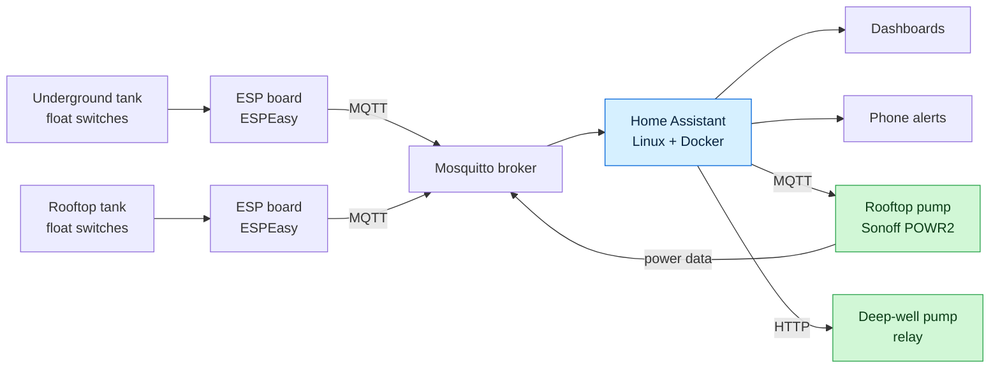
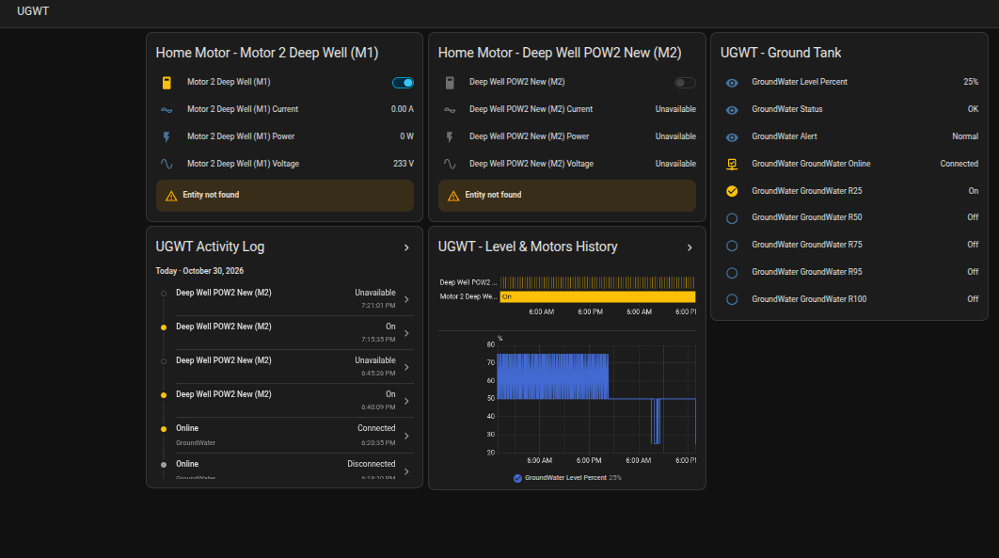
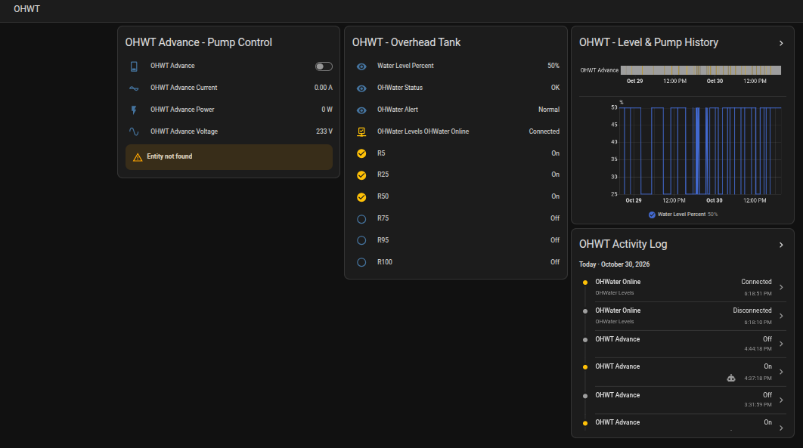
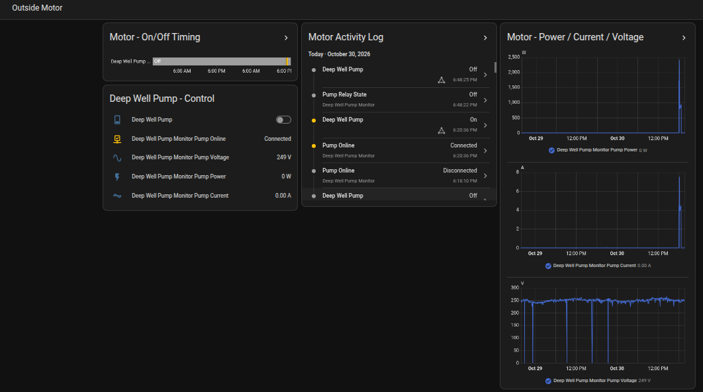
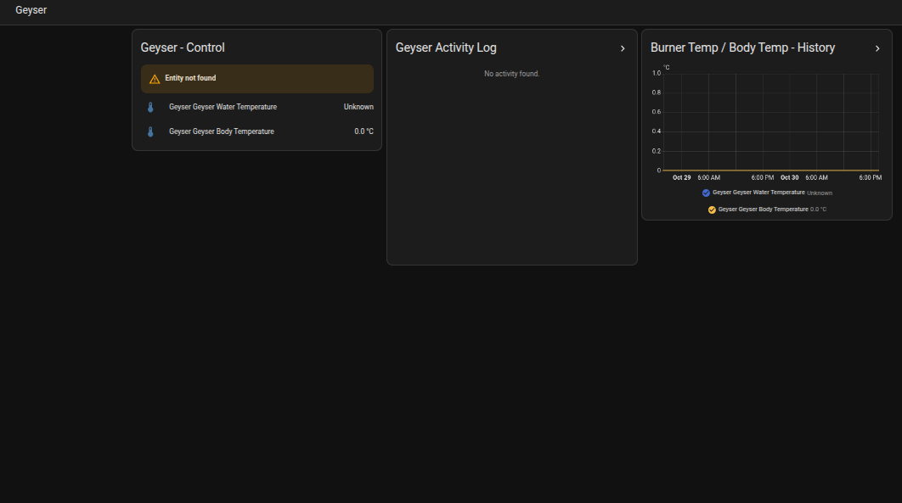

# Smart Water Management (Home IoT)

A real home IoT system that monitors two water tanks and runs the pumps automatically. Float-switch sensors on ESP8266/ESP32 boards report water levels over MQTT to Home Assistant, which fills the tanks, protects the pumps and sends phone alerts.

## Highlights

- 💧 **Automatic filling**: the rooftop tank refills itself when low and stops when full
- 🛡️ **Pump protection**: dry-run protection, a maximum runtime, and an automatic stop if a sensor goes offline
- ⚡ **Power monitoring**: live voltage, current and power for both pumps
- 🌙 **Peak-hour rules**: partial filling between 18:00 and 22:00, with a smart exception
- 📱 **Phone alerts**: low and high water levels, and every safety stop
- ✅ **Validated automatically**: every change is checked with Home Assistant's own config checker on GitHub Actions

## How it works

1. Float switches at fixed heights tell the ESP boards how full each tank is.
2. The boards publish the readings over MQTT.
3. Home Assistant turns them into a level (for example, 50%) and runs the automations.
4. Pumps are switched over MQTT (Sonoff) or HTTP (ESPEasy relay).

## Automations

| Automation | What it does |
|---|---|
| Low start | Starts the rooftop pump at ≤ 25%, only if the underground tank has water |
| Full cutoff | Stops the rooftop pump at 95% and the deep-well pump at 100%, re-checked every minute |
| Peak hours | 18:00–22:00: stops the rooftop pump at 50%, unless the underground tank is full and still filling |
| Priority fill | Fills the rooftop tank when the underground tank is full and the deep-well pump is running |
| **Dry-run protection** | Stops the rooftop pump if the underground tank is empty |
| **Sensor offline** | Stops all pumps if a tank controller is offline for 1 minute |
| **Max runtime** | Stops a pump that runs far longer than normal (stuck float switch) |
| Alerts | Phone notifications for low and high levels and for every safety stop |

## Dashboards

| Underground tank | Rooftop tank |
|---|---|
|  |  |
| **Pump power monitoring** | **Geyser** |
|  |  |

Screenshots are from the live system, so some entity names differ from the example configuration.

## Tech stack

Home Assistant · MQTT (Mosquitto) · ESP8266 / ESP32 · ESPEasy · Sonoff POWR2 · Linux · Docker · YAML · GitHub Actions

## Files

| File | Contents |
|---|---|
| `configuration.yaml` | Sensors, level templates, pump switches, notifications |
| `automations.yaml` | Pump control, safety rules and alerts |
| `secrets.yaml.example` | The private values to fill in (pump relay URLs) |
| `scripts/check_entities.py` | Checks that every entity used by an automation exists |
| `screenshots/` | Dashboard screenshots |

## Security and safety

- No real addresses, credentials or device IDs are published; private values belong in `secrets.yaml` (git-ignored).
- In a real installation, use an MQTT username and password, keep IoT devices on a separate network, and protect the ESPEasy web interface.
- Software automations are not a substitute for hardware protection: use a dry-run relay, overload protection and proper wiring.

## Author

**Ahsan Baig Chughtai** · [GitHub](https://github.com/abchughtai786)

## License

[MIT](LICENSE)
